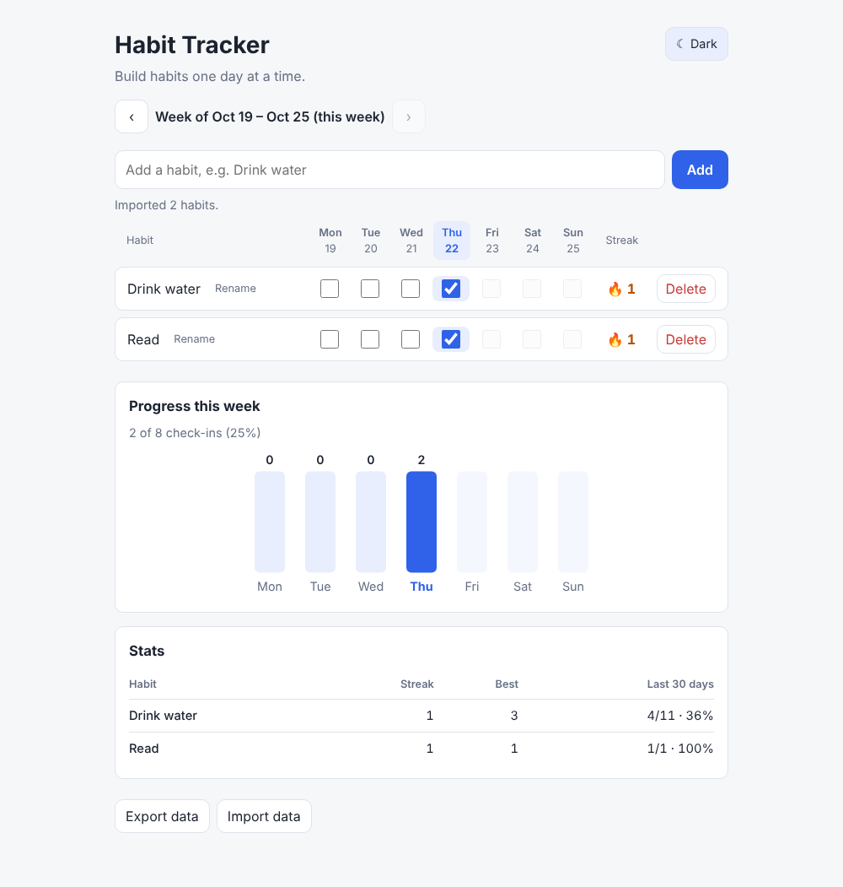
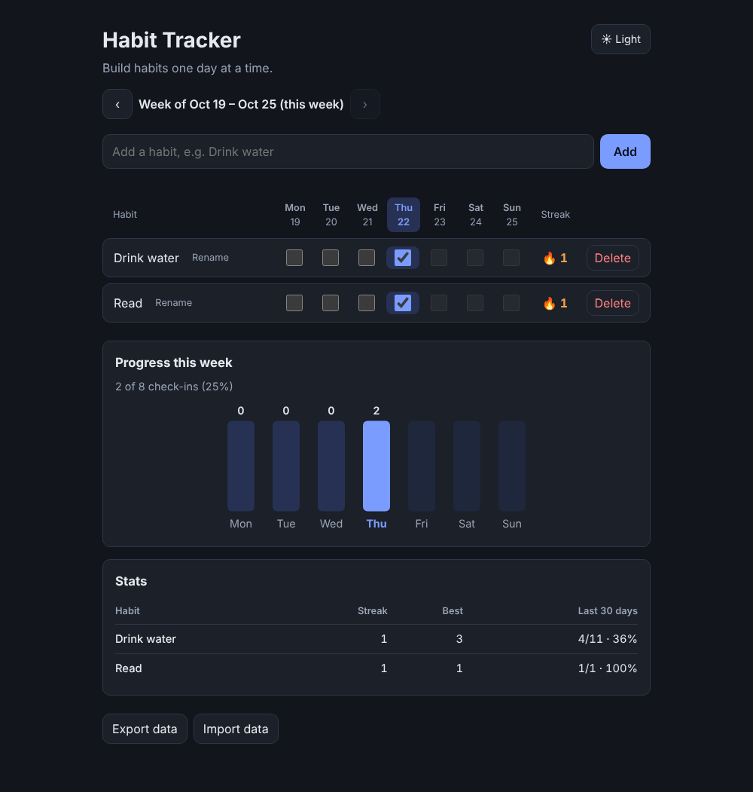
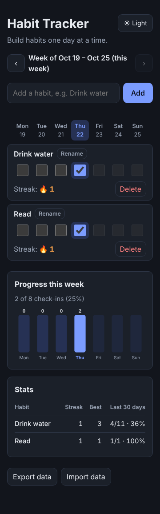

# Habit Tracker

A single-page habit tracker in plain HTML, CSS and JavaScript. No build step, no dependencies.

| Light | Dark | Phone |
|---|---|---|
|  |  |  |

## Run it

Open `index.html` in any modern browser (double-click it). Your habits and check-ins are saved in the browser's `localStorage`, so they stay after you reload or close the tab.

## How it works

- Add habits with the input at the top. Rename one with the Rename button (Enter or clicking away saves, Escape cancels) and remove it with Delete. Names are trimmed and must be unique.
- Use the arrows above the grid to look at earlier weeks and fix a missed check-in; "This week" jumps back. You can't go past the current week.
- Each habit has a checkbox for every day of the current week (Monday to Sunday). Today's column is highlighted. Future days are locked.
- The streak counter shows how many days in a row you have completed the habit. If you haven't checked today yet, the streak still counts up to yesterday, so it isn't shown as broken during the day.

- **Dark mode:** follows your system setting by default. The button in the top corner switches it, and your choice is remembered.
- **Progress this week:** a bar chart of how many habits you completed each day, with a total for the week. It follows whichever week you are viewing.
- **Stats:** per habit, the current streak, your best streak ever, and the share of days completed over the last 30 days (counted from when the habit started, so new habits aren't penalised).
- **Backup:** "Export data" downloads a JSON file. "Import data" restores one, after asking for confirmation because it replaces what you have now. Files are validated and cleaned on import, so a damaged or unrelated file is refused. Use this to back up your data or move it to another browser.

## Status

Milestones 1 to 4 are done: persistence, add/delete/rename, weekly checkboxes, streaks, week navigation, dark mode, weekly chart, stats, and JSON backup. Not built yet: reordering habits. See [PLAN.md](PLAN.md) for the roadmap.

## Files

| File | Purpose |
|---|---|
| `index.html` | Page markup |
| `style.css` | Styles and theme variables |
| `storage.js` | Loading and saving state in `localStorage` |
| `dates.js` | Local-date helpers, week days and streak logic |
| `charts.js` | Weekly bar chart (SVG) and stats table |
| `app.js` | State, rendering, theme, backup and events |
| `tests.js`, `tests.html` | Logic checks for `dates.js` and for the validation in `storage.js` |

## Running the checks

Open `tests.html` in a browser; it lists every check and whether it passed.

With Node installed you can also run them from the command line:

```
node -e "require('./dates.js'); require('./storage.js'); require('./tests.js'); const r = globalThis.HabitTestResults; console.log(r.filter(x => !x.ok).length ? 'FAILED' : 'all ' + r.length + ' passed')"
```

Try different time zones to check daylight-saving handling, e.g. `TZ=America/New_York node -e "..."`.

## Data format

Stored under the `habitTracker.v1` key:

```json
{
  "version": 1,
  "settings": { "theme": "dark" },
  "habits": [
    { "id": "h_abc", "name": "Drink water", "createdAt": "2026-10-20", "completions": ["2026-10-19", "2026-10-20"] }
  ]
}
```

Dates are local `YYYY-MM-DD` strings; streaks and stats are computed from them, never stored. `settings.theme` is optional and only present once you have used the theme button. The export file has exactly this format.
